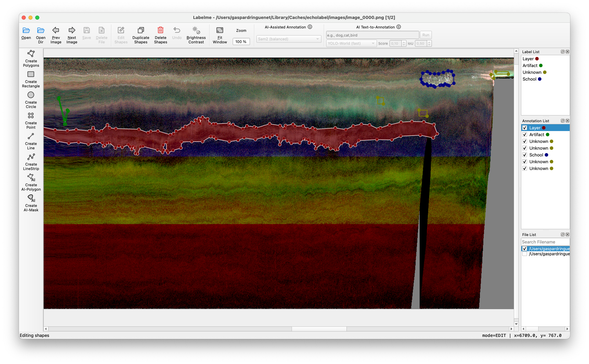

# `echolabel` - Interactive Echogram Annotation

> A [Labelme](https://github.com/wkentaro/labelme) wrapper enabling fast echogram annotation with CSV outputs compatible
> with [Echoregions](https://github.com/echostack-org/echoregions/).



## Installation

Requires Python 3.12 or newer.

```bash
pip install "git+https://github.com/gaspardringuenet/echolabel.git"
```

This installs the `echolabel` command.

## Quick start

```bash
echolabel process -s data.zarr -o regions.csv -f 38000 --cmap magma
```

- `-s/--source`: an echogram source (`.nc`, `.zarr`, or a directory of `.nc` files).
- `-o/--output`: the region CSV to create, or to edit if it already exists.
- `-f/--freqs-hz`: nominal frequency(ies) to use, repeatable.
- `--vmin`, `--vmax`, `--cmap`: display settings for the echogram images.
- `--reuse-images/--no-reuse-images`: reuse cached echogram images.
- `-c/--config`: optional configuration file.

Run `echolabel process --help` for all options.

The workflow:

1. Echolabel renders the echogram into images and writes one LabelMe JSON per image.
2. You annotate the regions in LabelMe.
3. Echolabel reads the JSON files back and writes the CSV.

## Main features

- **CSV in and out.** Regions are stored as CSV, compatible with Echoregions.
- **Required columns:** `region_id`, `time`, `depth`. The `region_name` column becomes the LabelMe label. A `shape_type` column is optional.
- **Pass-through columns.** Any other column (e.g. `region_class`, `region_bbox_*`) is carried through unchanged. `region_bbox_*` is recomputed from the geometry on export.
- **Depth clipping.** Regions that cross the top or bottom of an image are clipped to it for annotation. The unclipped region is kept in the CSV.
- **Time splitting.** Regions spanning several images are split into one shape per image. On export, shapes are merged back by `region_id` when they have the same label.
- **Rectangles.** Rectangles are exported with `shape_type` set to `rectangle`, using their four corners. On import, a row becomes a LabelMe rectangle when `shape_type` is `rectangle`, it has four points, and it is axis-aligned. This lets rectangles be edited as rectangles in a later run.
- **Region tracking.** `region_id` is kept across CSV → LabelMe → CSV, so existing regions keep their IDs.
- **Backup.** Before an existing output CSV is overwritten, it is copied to `<name>_backup.csv`.

## Output

Each exported row contains:

- `region_id`, `time`, `depth`, and the pass-through columns from the input
- `region_name` (the LabelMe label)
- `shape_type` (`polygon` or `rectangle`)
- `echolabel_version`, `flags`, `group_id`, `description`, taken from the LabelMe JSON
- `region_bbox_*`, recomputed from the geometry

Columns missing from the source CSV are added on export.

## Limit-case behaviour

| Situation | Behaviour |
|---|---|
| Region with no overlap with any image (above, below, or outside the time range) or with invalid geometry | Not shown in LabelMe, with a printed warning. The row is kept in the CSV unchanged. |
| Region crossing an image limit, unedited | The outside part is kept in the CSV. |
| Region crossing an image limit, with a visible shape deleted or modified in LabelMe (points, label, flags, group or description changed) | The outside part is dropped too, with a warning. Adding shapes without touching existing ones keeps it. |
| All visible shapes of a region deleted in LabelMe | The region is removed from the CSV, outside part included. |
| Shapes of one region forming several disconnected parts | Shapes are merged per label. The first part keeps `region_id`. The others get new IDs. |
| Shapes of different labels in one region | Never merged. Each label keeps its own shape, but only the first resulting part keeps `region_id`. |
| Shapes without a `region_id` | Exported as new regions with new IDs. |
| Rectangle with non-aligned corners | Imported as a polygon, with a warning. |
| Rectangle crossing an image limit, edited | Exported as a rectangle if all its shapes are rectangles and, together with the kept outside part, they still form an axis-aligned box. Otherwise exported as a polygon. |
| Unchanged rows | Written back with their original values. Only `echolabel_version` is updated, and a missing `shape_type` becomes `polygon`. |

## Licence

This project is licensed under the GNU General Public License v3.0. See [LICENSE](LICENSE).
