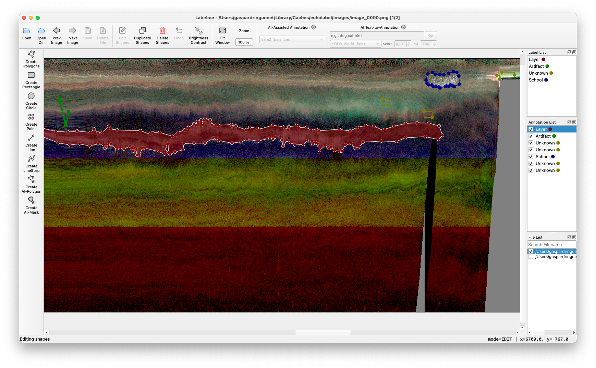
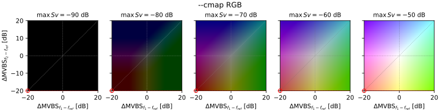
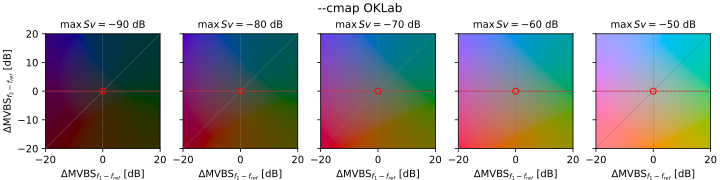

# Echolabel - Interactive Echogram Annotation

> A [Labelme](https://github.com/wkentaro/labelme) wrapper enabling fast echogram annotation with CSV outputs compatible
> with [Echoregions](https://github.com/echostack-org/echoregions/).


*LabelMe GUI open on RGB composite echogram image.*

## Installation

Requires Python 3.12 or newer.

After publication on PyPI, install a release with:

```bash
pip install echolabel
```

For the current GitHub version:

```bash
pip install "git+https://github.com/gaspardringuenet/echolabel.git"
```

This installs the `echolabel` command.

## Quick start

To download demo data and run with default parameters:

```bash
echolabel demo
```

Aside from demo, the `process` command is used to run the application:

```bash
echolabel process -s data.zarr -o regions.csv -f 38000 --cmap magma
```

- `-s/--source`: an echogram source (`.nc`, `.zarr`, or a directory of `.nc` files).
- `-o/--output`: the region CSV to create, or to edit if it already exists.
- `-f/--freq-hz`: nominal frequency(ies) to use, repeatable.
- `--vmin`, `--vmax`, `--cmap`: display settings for the echogram images.
- `--reuse-images/--no-reuse-images`: reuse cached echogram images.
- `-c/--config`: optional configuration file.

Run `echolabel process --help` for all options.

The workflow:

1. Echolabel renders the echogram into images and converts existing CSV regions to LabelMe annotations.
2. You annotate the regions in LabelMe.
3. Echolabel reads the JSON files back and writes the CSV.

## Colormaps

The default single-frequency colormap is `viridis`; select another Matplotlib colormap with `--cmap`.
For a three-frequency composite, select three frequencies **and** explicitly choose a composite:

```bash
echolabel process -s data.zarr -o regions.csv -f 38000 -f 70000 -f 120000 --cmap RGB
echolabel process -s data.zarr -o regions.csv -f 38000 -f 70000 -f 120000 --cmap OKLab
```

Frequency order matters. `RGB` maps the three frequencies to red, green and blue.
The rotated `OKLab` encoding uses the maximum Sv for lightness and the differences
between the second and third frequencies and the first (reference) frequency for
hue and chroma.

> The motivation for the `OKLab` colormap comes from perceptual limitations of the `RGB`
> representation, which has been used by deep sea ecologist. The goal is to get:
> 
> 1. Perceptually uniform lightness mapped to max(Sv) & independent of ΔSv → L ~ max(Sv) (clipped & rescaled)
> 2. Approx. uniform changes in color when moving in the ΔSv plane → a, b ~ ΔSv(f1), ΔSv(f2)
> 3. Colors roughly matching the `RGB` mode → (a, b) plane is rotated
>
> For more info on the OKLab color space, check [https://bottosson.github.io/posts/oklab/](https://bottosson.github.io/posts/oklab/).



*Visualization of multifrequency composite echogram colormaps available in Echolabel. Red dashed line (resp. red dot) corresponds
to the case in which f2 (resp. f2 and f1) is NA, which typically happens in acoustic dataset because of frequency-dependent
range limitations.*

## Configuration

Run `echolabel config` to create a user configuration file, then edit its YAML.
For example, the OKLab defaults are:

```yaml
oklab:
    sat_max: 28.3 # spectral difference [dB] at maximum chroma
    l_range: [0.3, 0.75] # lightness at vmin and vmax
    c_max: 0.25 # maximum chroma before gamut adjustment
    theta: 2.67 # rotation in ΔMVBS plane [radians] (153°, hue is similar to RGB)
```

You can override individual settings; omitted ones retain their defaults. `vmin`
and `vmax` control the Sv range for all colormaps. The configuration also maps
dataset variables and frequency units; adjust `datavars` to match your data.
Annotation requires at least two time and depth samples per image. A final
single-ping remainder is added to the preceding frame, which can therefore be
one ping wider than `frame_width`.

`--reuse-images` keeps cached images and their metadata, but annotations are
always regenerated from the specified CSV; a new CSV starts with no annotations.
Echolabel rebuilds if the source path, source metadata, settings, or required
cached files differ. Directory metadata may not detect changes inside an existing
Zarr store or NetCDF directory: use `--no-reuse-images` after modifying source data.

### Data formats & variable names

The acoustic dataset input as the `--source` argument can be either a Zarr store,
a NetCDF file, or a directory containing several NetCDF files (which must be
compatible with concatenation on the time axis).

As naming conventions vary accross datasets, Echolabel will try to find the
acoustic variable to plot and the time, depth and channel dimensions. The `--freq-hz`
argument maps to the optional frequency coordinate (which must be indexed by the
channel dimension, and defaults to it). In case frequency is encoded in kHz in the
dataset, a scaling factor can be set up. 

The user can edit all those in the configuration file. The following is used as
default:

```yaml
datavars:
    acouvar: Sv # Acoustic variable to display on echogram
    tvar: time # Ping axis dimension
    zvar: depth # Range axis dimension
    cvar: channel # Channel dimension
    fvar: null # (Optional) Frequency coordinate. Defaults to cvar.
    fvar_unit_scale: 1 # (Optional) Frequency unit conversion factor to Hz (1000 if coord is in kHz)
```

In addition to the configuration settings, Echolabel will try the Echopype convention
("Sv", "ping_time", "depth", "channel", "frequency_nominal", no scaling) and the
IMOS convention ("Sv", "time", "depth", "channel", None, 1000).

## Python API

```python
from echolabel import Config, EcholabelApp

config = Config.load()  # package defaults or the user's configuration
config.channels_frequency_nominal = [38000.0, 70000.0, 120000.0]
config.echogram_cmap = "OKLab"
config.update({"oklab": {"theta": 0.0}})
config.reuse_images = False

app = EcholabelApp(config)
app.run("data.zarr", "regions.csv")
```

`run` opens LabelMe and writes the CSV after it closes. Use `Config.from_file(path)`
to load a particular YAML file, or `EcholabelApp(config, cache_dir=path)` to choose
a cache directory.

## Main features

- **CSV in and out.** Regions are stored as CSV, compatible with Echoregions.
- **Required columns:** `region_id`, `time`, `depth`. The `region_name` column becomes the LabelMe label. A `shape_type` column is optional.
- **Pass-through columns.** Any other column (e.g. `region_class`, `region_bbox_*`) is carried through unchanged. `region_bbox_*` is recomputed from the geometry on export.
- **Depth clipping.** Regions that cross the top or bottom of an image are clipped to it for annotation. The unclipped region is kept in the CSV.
- **Time splitting.** Regions spanning several images are split into one shape per image. On export, shapes are merged back by `region_id` when they have the same label.
- **Rectangles.** Rectangles are exported with `shape_type` set to `rectangle`, using their four corners. On import, a row becomes a LabelMe rectangle when `shape_type` is `rectangle`, it has four points, and it is axis-aligned. This lets rectangles be edited as rectangles in a later run.
- **Region tracking.** `region_id` is kept across CSV → LabelMe → CSV, so existing regions keep their IDs.
- **Backup.** Before an existing output CSV is overwritten, it is copied to `<name>_backup.csv`.
  Existing backups are kept; later copies use `<name>_backup_1.csv`, `<name>_backup_2.csv`, and so on.

## Output

Each exported row contains:

- `region_id`, `time`, `depth`, and the pass-through columns from the input
- `region_name` (the LabelMe label)
- `shape_type` (`polygon` or `rectangle`)
- `echolabel_version`, `flags`, `group_id`, `description`, taken from the LabelMe JSON
- `region_bbox_*`, recomputed from the geometry

Columns missing from the source CSV are added on export.

The output is immediately usable with Echoregions:

```python
import echoregions as er

regions = er.read_regions_csv("regions.csv")
```

## Limit-case behaviour

| Situation | Behaviour |
|---|---|
| Region with no overlap with any image (above, below, or outside the time range) or with invalid geometry | Not shown in LabelMe, with a printed warning. The row is kept in the CSV unchanged. |
| Region crossing an image limit, unedited | The outside part is kept in the CSV. |
| Region crossing an image limit, with a visible shape deleted or modified in LabelMe (points, label, flags, group or description changed) | The outside part is dropped too, with a warning. Adding shapes without touching existing ones keeps it. |
| All visible shapes of a region deleted in LabelMe | The region is removed from the CSV, outside part included. |
| Shapes of one region forming several disconnected parts | Shapes are merged per label. The first part keeps `region_id`. The others get new IDs. |
| Shapes of different labels in one region | Never merged. Each label keeps its own shape, but only the first resulting part keeps `region_id`. |
| Shapes without a `region_id` | Exported as new regions with new IDs. |
| Rectangle with non-aligned corners | Imported as a polygon, with a warning. |
| Rectangle crossing an image limit, edited | Exported as a rectangle if all its shapes are rectangles and, together with the kept outside part, they still form an axis-aligned box. Otherwise exported as a polygon. |
| Unchanged rows | Written back with their original values. Only `echolabel_version` is updated, and a missing `shape_type` becomes `polygon`. |

## Licence

This project is licensed under the GNU General Public License v3.0. See [LICENSE](LICENSE).
